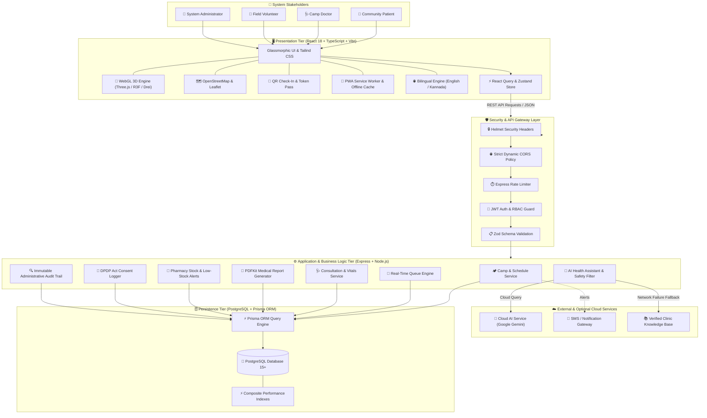

# 🏛️ System Architecture Specification
## Smart Community Health Camp Management System — Ultimate 3D Edition

This document details the complete technical architecture, data flow paths, security boundaries, and modular component integrations of the platform.

---

## 1. High-Level System Architecture Diagram

---

## 2. Layer-by-Layer Architectural Breakdown

### 2.1 Presentation Tier (Frontend)
- **Framework**: React 18 with TypeScript compiled via Vite for instant Hot Module Replacement (HMR) and optimized vendor code splitting.
- **Visual Design**: Modern glassmorphic healthcare theme using Tailwind CSS, customizable with dynamic light and dark mode toggles.
- **3D Graphics Subsystem**: Three.js, React Three Fiber (`@react-three/fiber`), and Drei (`@react-three/drei`). Renders interactive medical models, heartbeat monitors, and clinic buildings with frame rate clamping (`dpr={[1, 1.5]}`) for fluid performance on mobile devices.
- **Cartography**: Leaflet and OpenStreetMap rendering camp geographic markers, taluk coordinates, and live routing cues without commercial API keys.
- **Client Offline Tolerance**: Progressive Web App service worker (`sw.js`) with IndexedDB queue synchronization for camp venues with spotty cellular connection.

### 2.2 Security & API Gateway Layer
- **Transport Security**: HTTPS / TLS transport with strict HTTP security headers powered by `helmet`.
- **Dynamic CORS**: Whitelist validation supporting local development hosts (`localhost:3000`, `127.0.0.1:3000`) and deployed client domains on Vercel/Netlify.
- **Rate Limiting**: Multi-tiered IP rate limiter (`express-rate-limit`) protecting authentication endpoints against brute-force attacks and general API endpoints from denial-of-service, with development loopback bypass.
- **Request Validation**: Zod schemas validating all incoming request payloads (`req.body`, `req.query`, `req.params`) prior to business logic execution.

### 2.3 Application & Services Tier (Backend)
- **Authentication Service**: Dual JWT architecture generating 15-minute access tokens and 7-day refresh tokens with cryptographic signature verification.
- **Transaction-Safe Queue Engine**: Atomic reservation transactions preventing overbooking when camps operate at capacity ($N / N$ capacity constraint).
- **Clinical Documentation Engine**: Captures vital statistics (blood pressure, pulse, SpO2, blood sugar), physician observations, and diagnostic classifications.
- **Report & PDF Generator**: Server-side document generation using `PDFKit`, outputting branded, signed diagnostic summary certificates.
- **AI Health Assistant with Medical Guard**: Secure server-side query processing supporting Google Gemini. Intercepts prescription and dosage requests using safety regex patterns, redirecting users to licensed physicians. Includes a fallback local knowledge base in English and Kannada.

### 2.4 Data Persistence Tier
- **Database Engine**: PostgreSQL 15+ relational database with strict foreign key constraints and cascade deletion rules.
- **ORM**: Prisma Client providing type-safe database queries, atomic `$transaction` blocks, and connection pooling.
- **Performance Indexes**:
  - `Camp([status, startDate], [location])`: Accelerates camp discovery and active schedule filtering.
  - `Appointment([campId, date], [status], [patientId])`: Optimizes slot availability checks and queue lookups.
  - `User([role])`: Accelerates role-based directory queries.
  - `MedicalReport([patientId], [campId], [status])`: Enforces fast ownership lookups for patient report access.
