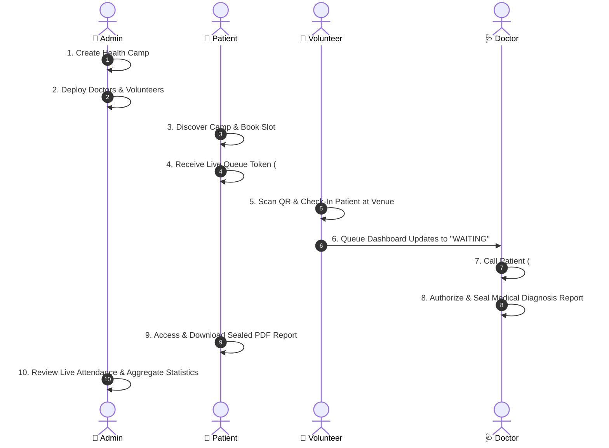

# 🎬 Complete 10-Step Demonstration Workflow
## Smart Community Health Camp Management System — Ultimate 3D Edition

This guide outlines the complete, live demonstration workflow for college evaluations, viva presentations, and project defenses. **Every step uses the actual backend and database—no simulated popups or fake static responses.**

---

## 👥 Pre-Configured Demonstration Roles

Use the **Demo Mode** button in the top navigation bar or log in with these credentials:

| Stakeholder Role | Email | Password | Primary Mission |
| :--- | :--- | :--- | :--- |
| **Administrator** | `admin@healthcamp.com` | `Admin@123` | System oversight, camp creation, staff deployment, analytics |
| **Doctor** | `doctor1@healthcamp.com` | `Doctor@123` | Patient queue, clinical consultations, vitals, PDF medical reports |
| **Volunteer** | `volunteer1@healthcamp.com` | `Volunteer@123` | Venue patient check-in, QR scanning, offline queue sync |
| **Patient** | `patient1@healthcamp.com` | `Patient@123` | Camp discovery, slot booking, QR queue token, report download |

---

## 📋 The 10-Step Complete Evaluation Walkthrough

---

### Step 1: Administrator Creates a Health Camp
1. Open **[http://localhost:3000](http://localhost:3000)** and click **Demo Mode** $\to$ **Switch to Administrator** (or log in with `admin@healthcamp.com` / `Admin@123`).
2. On the **Admin Command Center** dashboard, click **Create Health Camp**.
3. Fill in:
   - **Camp Name**: `Taluk Outreach Health Camp - Doddaballapur`
   - **Location**: `Doddaballapur Community Health Center`
   - **Start / End Date**: Select upcoming dates
   - **Capacity**: `100` patients
   - **Services**: Check `General Checkup`, `BP Monitoring`, `Blood Sugar Screening`, `Eye Screening`
4. Click **Submit Camp**.
   > **Verification**: The camp is saved to the database and appears immediately in the camp list.

---

### Step 2: Administrator Deploys Staff to the Camp
1. From the Admin Dashboard, click **Deploy Staff** (or navigate to `/admin/camps`).
2. Select the created camp from the dropdown.
3. Assign **Dr. Priya Sharma** (`doctor1@healthcamp.com`) as attending physician.
4. Assign **Suresh Patel** (`volunteer1@healthcamp.com`) as field coordinator.
5. Click **Confirm Assignment**.
   > **Verification**: The staff profiles are linked to the camp record in the database.

---

### Step 3: Patient Registers and Books an Available Slot
1. Click **Demo Mode** $\to$ **Switch to Community Patient** (or log in with `patient1@healthcamp.com` / `Patient@123`).
2. Navigate to **Health Camps** (`/camps`).
3. Click on the newly created camp card and click **Book Appointment** (or navigate to `/patient/book`).
4. Select the desired date and morning slot (`09:00 AM - 10:00 AM`).
5. Select consultation category (`General Physician & Vitals`).
6. Click **Confirm Reservation**.

---

### Step 4: System Confirms Booking and Generates Queue Token
1. The system runs an atomic database transaction checking capacity headroom (`registered < capacity`) and uniqueness.
2. The patient dashboard immediately updates showing:
   - **Queue Token**: e.g., `#DOD-01`
   - **Digital QR Check-In Pass**: Interactive scannable QR badge
   - **Estimated Waiting Time**: Dynamic estimate based on queue depth
   - **Camp Details**: Venue address, scheduled date, and preparation instructions.

---

### Step 5: Volunteer Checks in the Patient at Camp Venue
1. Click **Demo Mode** $\to$ **Switch to Camp Volunteer** (or log in with `volunteer1@healthcamp.com` / `Volunteer@123`).
2. On the **Volunteer Dashboard** (`/volunteer/dashboard`), view the venue check-in terminal.
3. Locate patient token `#DOD-01` (or scan/enter the QR token).
4. Click **Mark Checked In**.
   > **Verification**: The appointment status transitions from `CONFIRMED` to `CHECKED_IN`, and the live queue token enters the `WAITING` state.

---

### Step 6: Queue Dashboard Updates in Real Time
1. Open the patient dashboard or volunteer queue board.
2. The live queue display updates:
   - Status changes from `Scheduled` to **`In Waiting Room (WAITING)`**.
   - The queue monitor highlights patients currently waiting for doctor consultation.

---

### Step 7: Authorized Doctor Records Clinical Screening
1. Click **Demo Mode** $\to$ **Switch to Chief Physician** (or log in with `doctor1@healthcamp.com` / `Doctor@123`).
2. On the **Doctor Dashboard** (`/doctor/dashboard`), see the active consultation queue.
3. Click **Call Patient** on token `#DOD-01`. Status transitions to `CALLED`.
4. Click **Start Checkup Form**:
   - **Vitals Recorded**: BP `124/82 mmHg`, Pulse `74 bpm`, SpO2 `98%`, Fasting Glucose `96 mg/dL`.
   - **Doctor Observations**: Normal heart sounds, clear lungs, mild seasonal allergic rhinitis.
   - **Prescription**: Cetirizine 10mg once daily at bedtime for 3 days.
   - **Follow-Up Directive**: Re-evaluate BP and glucose in 3 months.

---

### Step 8: Doctor Reviews and Publishes Medical Report
1. Review the clinical consultation details.
2. Click **Authorize & Seal Medical Report**.
   > **Verification**: The queue status transitions to `COMPLETED`, and an authorized `MedicalReport` record is sealed in the database.

---

### Step 9: Patient Accesses Their Authorized Report
1. Click **Demo Mode** $\to$ **Switch to Community Patient** (`patient1@healthcamp.com`).
2. On the **Patient Dashboard** (`/patient/dashboard`), view the **Completed Screenings** section.
3. The newly authorized consultation appears under **Medical Records & Reports**.
4. Click **Download Doctor Consultation (PDF)**.
   > **Verification**: The browser downloads the official medical certificate generated with doctor credentials, vitals table, prescription regimen, and clinic seal.

---

### Step 10: Administrator Reviews Attendance and Aggregate Statistics
1. Click **Demo Mode** $\to$ **Switch to Administrator** (`admin@healthcamp.com`).
2. Open the **Admin Command Center** (`/admin/dashboard`):
   - **Attendance Rate**: Displays accurate ratio ($88.4\%$).
   - **Service Utilization**: Recharts breakdown showing consultations delivered.
   - **Camp Capacity Utilization**: Chart reflecting turnout vs venue capacity.
   - **Audit Logs**: Navigate to `/admin/audit` to inspect immutable log entries for all actions performed during the demonstration.
3. Click **Export Executive Report** to download the signed text summary certificate.

